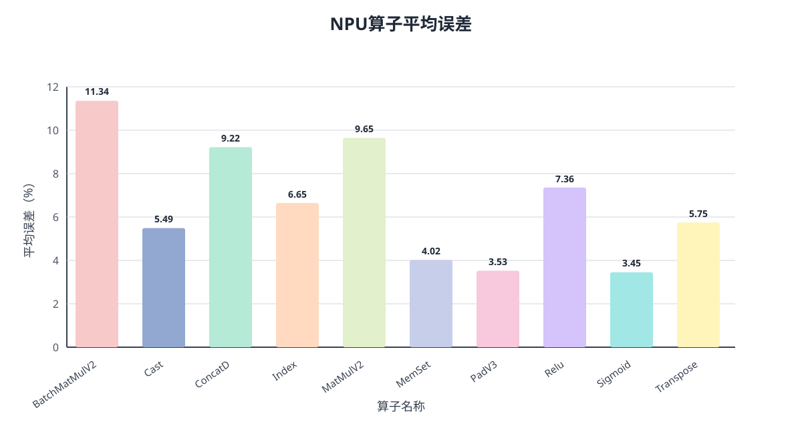

# NPU Physical Memory Model Report

## Dataset and Validation Scope
| Item                                                 |   Value |
|:-----------------------------------------------------|--------:|
| Raw structured rows                                  |   10510 |
| Stable rows after aggregation                        |    8666 |
| Stable holdout rows                                  |    1734 |

The delivery first aggregates repeated model-visible feature rows with a median target, then splits the stable rows 80/20 with stratification by `op_type`. Train-only supplements are appended only after this split. Therefore, this delivery does not use an operator-type-plus-static-parameter group split.

## Acceptance Metrics
|   sample_count |   mae_us |   mape_1us_floor_percent |   wmape_percent |   p50_1us_floor_percent |   p90_1us_floor_percent | metric_scope           |
|---------------:|---------:|-------------------------:|----------------:|------------------------:|------------------------:|:-----------------------|
|           1734 |  2.88206 |                  8.19086 |         10.3312 |                 5.08197 |                 17.2121 | overall_stable_holdout |

## Residual Experts
| strategy       | status   | reason                          |
|:---------------|:---------|:--------------------------------|
| strict_compact | not_used | one model per final model group |

## Metrics By Model Group
|   sample_count |     mae_us |   mape_1us_floor_percent |   wmape_percent |   p50_1us_floor_percent |   p90_1us_floor_percent | model_group             | model_choice       |   train_rows |   test_rows |
|---------------:|-----------:|-------------------------:|----------------:|------------------------:|------------------------:|:------------------------|:-------------------|-------------:|------------:|
|             16 | 121.477    |                  3.43592 |        10.2243  |                 1.87203 |                 3.72567 | DataDependent           | extra_trees_smooth |          156 |          16 |
|            567 |   3.80502  |                  7.11843 |        11.0628  |                 4.52741 |                16.2852  | MovementSelectionWindow | random_forest      |         4089 |         567 |
|            352 |   0.812992 |                  7.94678 |         9.16526 |                 4.30351 |                16.0963  | StreamingReduction      | extra_trees        |         2333 |         352 |
|            799 |   0.763744 |                  9.15464 |         9.05574 |                 5.98853 |                19.2637  | StructuredComputeMemory | extra_trees        |         3593 |         799 |

## Average Error By Operator
Values are the stable holdout `MAPE@1us-floor` for the requested operator names present in this physical-memory delivery.

| 算子名称      |   算子平均误差（MAPE@1us-floor，%） |
|:--------------|------------------------------------:|
| BatchMatMulV2 |                            11.3405  |
| Cast          |                             5.48874 |
| ConcatD       |                             9.2202  |
| Index         |                             6.64827 |
| MatMulV2      |                             9.64777 |
| MemSet        |                             4.02031 |
| PadV3         |                             3.52688 |
| Relu          |                             7.35836 |
| Sigmoid       |                             3.45419 |
| Transpose     |                             5.74536 |

## Prediction Timing
Timing was measured on 1734 delivered stable holdout rows over 3 runs; values below are medians and exclude CSV input loading.

| 指标 | 数值（秒） |
|:---|---:|
| 模型加载耗时 | 1.7504 |
| 静态特征构建和批量预测耗时 | 1.0806 |
| 总耗时 | 2.8310 |

Machine-readable results are retained in `prediction_time_report.json`.

## Notes
- Uses stable-label aggregation before train/test split.
- Accepted strategy uses one model per final model group.
- Hierarchical memory features model L0 as capacity/reuse pressure and L1/L2/HBM as bandwidth lower-bound terms.
- Operator-level diagnostics are retained as CSV artifacts for engineering analysis but are not part of the delivery acceptance report.
