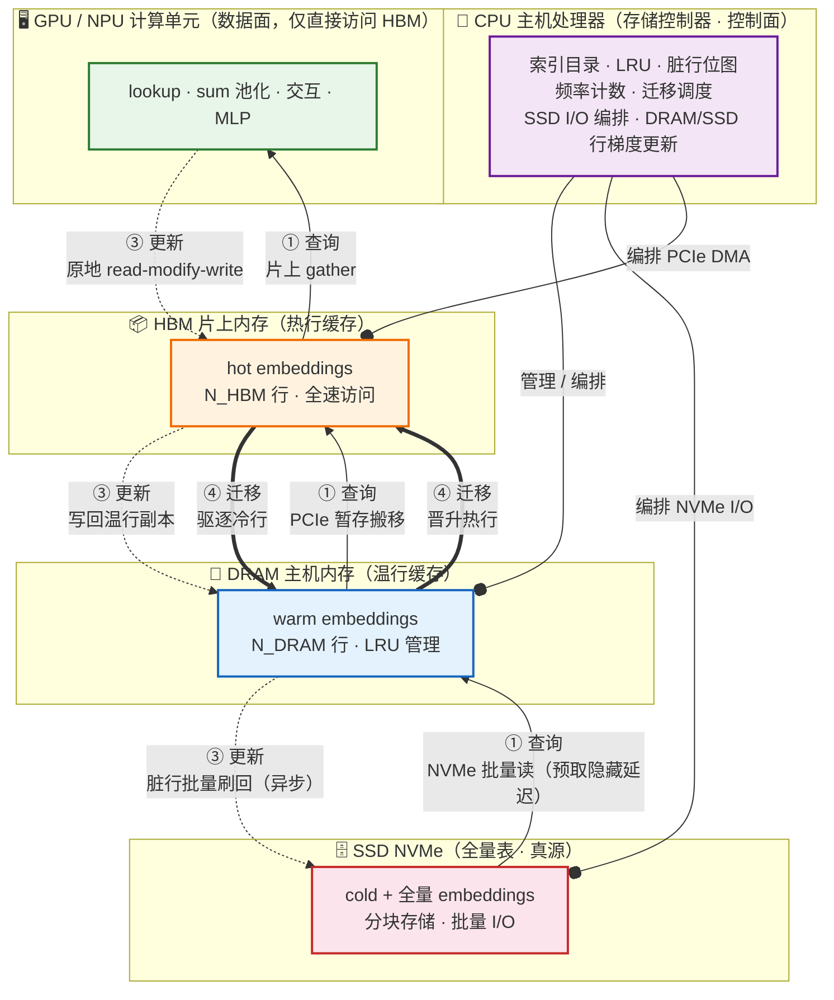

# DLRM 三级存储数据流转图

下图以**一张图**展示业界主流三级存储 DLRM（以 MTrainS 为代表）中，数据在 GPU/NPU、HBM、DRAM、SSD 四级之间随 **查询（读）、更新（写）、迁移（双向）** 三类行为流转，以及 **CPU 作为存储控制器（控制面）** 的编排作用。



## 图例说明

| 线型 | 行为 | 方向 | 是否在关键路径 |
|------|------|------|:---:|
| 实线 `-->` | ① 查询 LOOKUP（数据面） | 自下而上 SSD→DRAM→HBM→GPU | ✅ 是 |
| 虚线 `-.->` | ③ 更新 UPDATE / 写回（数据面） | 自上而下 GPU→HBM→DRAM→SSD | 部分（SSD 刷回异步） |
| 粗线 `==>` | ④ 迁移 MIGRATION（数据面） | 双向 DRAM↔HBM | ❌ 否（后台） |
| 圆圈 `--o` | 控制面（CPU 编排） | CPU → 各存储层 | ❌ 否（但决定吞吐上限） |

## 三类行为 + 控制面的核心要点

- **① 查询（读，数据面）**：每个 batch 的稀疏索引按命中层级走不同长度的读链路；SSD 段用**批量读 + 预取**把 NVMe 延迟藏到计算后面；DRAM 命中经 PCIe 暂存到 HBM 后由 GPU gather（暂存搬运，不改变 HBM 常驻集）。
- **③ 更新（写，数据面）**：HBM 常驻行原地 read-modify-write（零跨层流量）；DRAM 行写回主机副本；SSD 行更新后标记脏行、**合并批量**异步刷回真源——SSD 随机写远慢于读，是训练场景的主要开销。
- **④ 迁移（双向，数据面）**：按衰减访问频率周期重排，晋升最热行到 HBM、驱逐最冷行到 DRAM/SSD，后台执行、不与在线查询争抢关键路径。
- **控制面（CPU）**：GPU 只直接访问 HBM；DRAM、SSD 均在主机侧，由 CPU 直接管理。所有搬移（NVMe、PCIe）都是 **DMA**——CPU 发起并调度、不逐字节搬运，但**索引目录、LRU、脏行追踪、频率计数、迁移决策、I/O 编排全部落在 CPU**，是除 SSD 写回外的另一类隐蔽瓶颈。

---

# 解析建模（Analytical Modeling）

> 本节对上面 dataflow 图中的各条数据通路做**纯解析建模**：不跑 DLRM、不回放 trace、不依赖 profiling，命中率与操作次数全部由 Zipf 参数 + 硬件规格闭式推出。核心公式仍是 $T = \tau\cdot n + DataSize/BW$，区别只在于 **n 的解析来源**。

## 1. 解析建模四步流水线

```
输入: α(Zipf), N, K=B·k·T, m, b, N_HBM, N_DRAM, N_SSD, {τ_i, BW_i}
   │
   ▼
Step 1  命中率解析      Zipf 调和数 → r_HBM, r_DRAM, r_SSD
   ▼
Step 2  操作次数解析     n_query(数据面/控制面) + n_update(写回) + n_migrate
   ▼
Step 3  延迟解析        T_i = τ_i·n_i + n_i·m·b / BW_i
   ▼
Step 4  汇总            T_latency(关键路径) / T_total(吞吐)
```

## 2. 两个解析源头

### ① 命中率（查询分布，推理 / 训练都需）

$$r_{HBM}=\frac{H_{N_{HBM}}(\alpha)}{H_N(\alpha)},\quad
r_{DRAM}=\frac{H_{N_{HBM}+N_{DRAM}}(\alpha)-H_{N_{HBM}}(\alpha)}{H_N(\alpha)},\quad
r_{SSD}=1-r_{HBM}-r_{DRAM}$$

其中 $H_M(\alpha)=\sum_{j=1}^{M}1/j^{\alpha}$ 为广义调和数，$N_{HBM}=C_{HBM}/(m\cdot b)$。

### ② 去重更新行数（写回分布，仅训练）

$$q_i(K)=1-(1-p_i)^K,\quad p_i=\frac{1/i^{\alpha}}{H_N(\alpha)},\qquad
n_{tier}^{upd}=\sum_{i\in tier}q_i(K),\quad tier\in\{HBM,DRAM,SSD\}$$

头部热行 $q_i\approx1\Rightarrow n_{HBM}^{upd}\approx N_{HBM}$；长尾冷行 $q_i\approx K p_i\Rightarrow n_{SSD}^{upd}\approx K\cdot r_{SSD}$。

## 3. 基础版：只建模查询读路径（无更新 / 删除 / SSD）

范围最小、最该先做对的版本。此时 $r_{HBM}+r_{DRAM}=1$，没有写、没有 miss、没有后台项。

### 3.1 命中率

$$r_{HBM}=\frac{H_{N_{HBM}}(\alpha)}{H_N(\alpha)},\qquad r_{DRAM}=1-r_{HBM}$$

### 3.2 操作次数

| 通路 | 次数 n |
|------|--------|
| HBM 数据面 | $n_{HBM}=r_{HBM}\cdot K$ |
| DRAM 数据面 | $n_{DRAM}=r_{DRAM}\cdot K$ |
| 控制面-HBM | $n_{ctrl\_hbm}=K$（每个查询测一次 `isin`） |
| 控制面-DRAM | $n_{ctrl\_dram}=r_{DRAM}\cdot K$（未命中 HBM 的走 CPU 串行查找） |

### 3.3 延迟

$$T_{HBM}=\tau_{HBM}\cdot n_{HBM}+n_{HBM}\cdot m\cdot b/BW_{HBM}$$
$$T_{DRAM}=\tau_{PCIe}\cdot n_{DRAM}+n_{DRAM}\cdot m\cdot b/BW_{PCIe}$$
$$T_{ctrl}=\tau_{ctrl\_hbm}\cdot K+\tau_{ctrl\_dram}\cdot n_{DRAM}$$
$$T_{query}=T_{HBM}+T_{DRAM}+T_{ctrl}$$

### 3.4 手算例子（α=1.0，N=100k，N_HBM=1k，N_DRAM=99k）

```
H_1000(1)   ≈ ln1000   + γ ≈ 7.485
H_100000(1) ≈ ln100000 + γ ≈ 12.09
→ r_HBM = 7.485/12.09 = 61.9%      r_DRAM = 38.1%

K = B·k·T = 128 × 10 × 8 = 10,240
n_HBM = 0.619 × 10240 = 6,340      n_DRAM = 0.381 × 10240 = 3,900
```

参数（m=64, b=4 → 256 B/行）：

| 段 | τ | BW |
|----|-----|-----|
| HBM→NPU | 0.02 μs | 50 GB/s |
| DRAM→NPU（PCIe） | 0.03 μs | 1.5 GB/s |
| 控制面-HBM | 0.001 μs | — |
| 控制面-DRAM | 0.1 μs | — |

```
T_HBM  = 0.02e-6 × 6340 + 6340×256/50e9  = 0.159 ms
T_DRAM = 0.03e-6 × 3900 + 3900×256/1.5e9 = 0.783 ms
T_ctrl = 0.001e-6 × 10240 + 0.1e-6 × 3900 = 0.400 ms
T_query = 0.159 + 0.783 + 0.400 = 1.342 ms
```

| 段 | 耗时 | 占比 |
|----|------|:---:|
| HBM gather | 0.159 ms | 11.8% |
| DRAM PCIe 搬移 | 0.783 ms | 58.3% |
| CPU 控制面 | 0.400 ms | 29.8% |

**结论**：DRAM 段主导（PCIe 带宽低）；CPU 控制面占近 30%，随 $r_{DRAM}\cdot K$ 线性增长，靠提带宽无法消除，只能靠去重、批量查找等实现优化。

## 4. 完整版：查询 + 更新 + 迁移 + 控制面

### ① 查询（读，推理 ✅ / 训练 ✅）

| 通路 | n | 延迟 T |
|------|---|--------|
| HBM→NPU | $r_{HBM}\cdot K$ | $\tau_1\cdot n+n\cdot m\cdot b/BW_{HBM\_read}$ |
| DRAM→NPU | $r_{DRAM}\cdot K$ | $\tau_2\cdot n+n\cdot m\cdot b/BW_{DRAM\_read}$ |
| SSD→DRAM | $r_{SSD}\cdot K$ | $\tau_3\cdot n+n\cdot m\cdot b/BW_{SSD\_read}$ |

### 控制面（CPU，推理 ✅ / 训练 ✅）

| 通路 | n | 延迟 T |
|------|---|--------|
| HBM 成员判定 `isin` | $K$ | $\tau_{ctrl\_hbm}\cdot K$ |
| DRAM 缓存串行查找 | $(r_{DRAM}+r_{SSD})\cdot K$ | $\tau_{ctrl\_dram}\cdot(r_{DRAM}+r_{SSD})\cdot K$ |

### ② 更新 / 写回（写，推理 ❌ / 训练 ✅）

| 通路 | n | 延迟 T |
|------|---|--------|
| NPU→HBM 原地 RMW | $n_{HBM}^{upd}$ | $\approx 0$（片上，忽略） |
| NPU→DRAM 写回 | $n_{DRAM}^{upd}$ | $\tau_{w\_dram}\cdot n+n\cdot m\cdot b/BW_{DRAM\_write}$ |
| NPU→DRAM→SSD 写回 | $n_{SSD}^{upd}$ | $\tau_{w\_ssd}\cdot n+n\cdot m\cdot b/BW_{SSD\_write}$ |

### ③ 迁移（双向，推理 ✅ / 训练 ✅，后台）

| 通路 | n | 延迟 T |
|------|---|--------|
| 晋升 DRAM/SSD→HBM | $N_{HBM}\cdot\eta$ | $\tau_{mig}\cdot n+n\cdot m\cdot b/BW_{PCIe}$ |
| 驱逐 HBM→DRAM/SSD | $N_{HBM}\cdot\eta$ | $\tau_{mig}\cdot n+n\cdot m\cdot b/BW_{PCIe}$ |

## 5. 汇总口径与带宽池

$$T_{query}=T_1+T_2+T_3+T_{ctrl},\quad
T_{update}=T_{w\_dram}+T_{w\_ssd},\quad
T_{migrate}=T_{promote}+T_{demote}$$

$$\text{关键路径（单次延迟）}:\quad T_{latency}=T_{query}+[\,T_{update}\text{ 若同步}\,]$$

$$\text{吞吐（全部争带宽）}:\quad T_{total}=T_{query}+T_{update}+T_{migrate}$$

- **推理**：$T_{update}$ 整项删除（无梯度、无写回），只剩 $T_{query}+T_{migrate}$。
- **训练**：四项全要，且 $T_{update}$ 里的 SSD 写回通常主导。

> **带宽池提醒**：三条物理链路上多个行为共用同一 PCIe / NVMe。应**按链路归并字节、除以一条 BW** $T_{PCIe}=\frac{\sum DataSize_j}{BW_{PCIe}}$，而非各行为 `DataSize/BW` 相加。尤其更新写回与迁移驱逐都向下写，同一脏行应**合并成一次写**，避免重复计数。

## 6. 参数来源（零 Profiling）

| 参数 | 来源 |
|------|------|
| $\alpha$（Zipf） | 请求日志拟合 / 训练数据统计 / 默认值 + 灵敏度分析 |
| $BW$（各链路） | 硬件 datasheet（HBM 带宽、PCIe 版本、NVMe 规格） |
| $N_{HBM},N_{DRAM}$ | 容量 $\div(m\cdot b)$ |
| $\tau$（per-op 固定延迟） | 硬件事务延迟（datasheet 或名义值） |
| $\tau_{ctrl\_dram}$ | 唯一"实现相关"项（CPU 单次 dict 查 ≈ 0.1~1 μs），给名义值 + 灵敏度分析 |

核心「解析」体现在：**命中率和操作次数完全由 Zipf 闭式推出**，不依赖 trace；$\tau/BW$ 是硬件输入，与「跑 DLRM 模型」无关。

## 7. 通路 × 推理/训练 适用性总表

| 行为 | 通路 | 方向 | n 来源 | 推理 | 训练 |
|------|------|------|--------|:---:|:---:|
| 查询 | HBM→NPU | 读 | $r_{HBM}\cdot K$ | ✅ | ✅ |
| 查询 | DRAM→NPU | 读 | $r_{DRAM}\cdot K$ | ✅ | ✅ |
| 查询 | SSD→DRAM | 读 | $r_{SSD}\cdot K$ | ✅ | ✅ |
| 控制 | 索引判定/缓存查找 | — | $K$、$(1-r_{HBM})\cdot K$ | ✅ | ✅ |
| 更新 | NPU→HBM 原地 | 写 | $n_{HBM}^{upd}$ | ❌ | ✅ |
| 更新 | NPU→DRAM | 写 | $n_{DRAM}^{upd}$ | ❌ | ✅ |
| 更新 | NPU→DRAM→SSD | 写 | $n_{SSD}^{upd}$ | ❌ | ✅ |
| 迁移 | DRAM/SSD→HBM 晋升 | 写 | $N_{HBM}\cdot\eta$ | ✅ | ✅ |
| 迁移 | HBM→DRAM/SSD 驱逐 | 写 | $N_{HBM}\cdot\eta$ | ✅ | ✅ |
