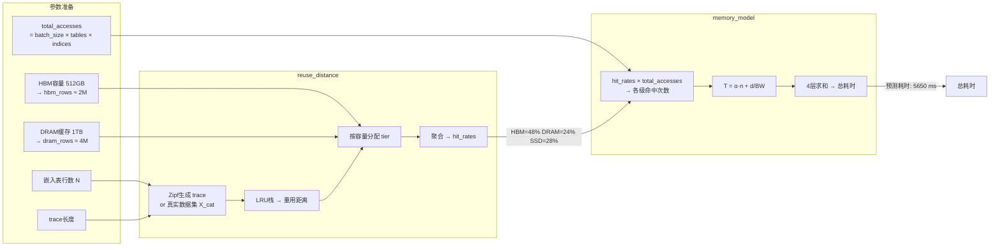

# DLRM 三级存储推理耗时建模流程

```mermaid
flowchart TB
    subgraph Input["① 输入"]
        direction LR
        A1["硬件容量<br/>HBM: 512GB<br/>DRAM: 1TB"]
        A2["模型配置<br/>N=100K rows<br/>dim=64000"]
        A3["访问模式<br/>Zipf / 真实trace"]
    end

    subgraph Step1["② reuse_distance.py — 哪层命中？"]
        direction TB
        B1["生成/加载 trace<br/>Zipf(N, trace_length)"] --> B2["LRU 栈遍历<br/>计算每个 embedding 的<br/>平均重用距离 avg_RD"]
        B2 --> B3["按 avg_RD 升序排序<br/>前 hbm_rows → HBM<br/>再 dram_rows → DRAM<br/>其余 → SSD"]
        B3 --> B4["按 tier + 访问频次聚合<br/>输出命中率比例"]
    end

    subgraph Step2["③ memory_model.py — 命中后花多少时间？"]
        direction TB
        C1["命中率 × total_accesses<br/>= 各级绝对命中次数"] --> C2["n × dim × 4 bytes<br/>= 各级数据搬运量"]
        C2 --> C3["T = α·n + DataSize / BW<br/>逐层计算耗时"]
        C3 --> C4["T_total = T_HBM + T_DRAM + T_SSD + T_migrate"]
    end

    subgraph Output["④ 输出"]
        direction LR
        D1["各级命中率<br/>HBM=48% DRAM=24% SSD=28%"]
        D2["各级耗时占比<br/>HBM=2% DRAM=19% SSD=79%"]
        D3["总耗时预测<br/>≈ 5650 ms/batch"]
    end

    subgraph Verify["⑤ 验证"]
        E1["compare_models.py<br/>13 组实测数据对比<br/>纯BW vs α+BW 模型"]
    end

    Input --> Step1
    Step1 -->|"hit_rates JSON"| Step2
    Step2 --> Output
    Output --> Verify

    style Step1 fill:#e1f5fe
    style Step2 fill:#fff3e0
    style Input fill:#f3e5f5
    style Output fill:#e8f5e9
    style Verify fill:#fce4ec
```



---

## 详细数据流



---

## 核心公式

```
┌─────────────────────────────────────────────────────┐
│  T_stage = α × n_hits  +  DataSize / BW             │
│            ↑                  ↑                      │
│        固定开销           带宽传输                    │
│      (设备唤醒、         (实际数据搬运)               │
│       队列延迟)                                      │
└─────────────────────────────────────────────────────┘

┌─────────────────────────────────────────────────────┐
│  T_total = T_HBM_to_NPU  + T_DRAM_to_CPU             │
│          + T_SSD_to_DRAM + T_DRAM_to_HBM             │
└─────────────────────────────────────────────────────┘
```

## 四级存储路径

```
          ┌──────────────────────┐
          │       NPU 计算单元    │
          └──────────┬───────────┘
                     │ 50 GB/s, 0.02 μs
          ┌──────────▼───────────┐
          │   HBM (片上 64GB)     │ ← 热数据
          └──────────┬───────────┘
                     │ 0.3 GB/s, 5 μs (迁移)
                     │
          ┌──────────▼───────────┐
          │   DRAM (主机 1.5TB)   │ ← 温数据
          └──────────┬───────────┘
                     │ 0.4 GB/s, 10 μs
          ┌──────────▼───────────┐
          │   SSD (NVMe)          │ ← 冷数据
          └──────────────────────┘
```

## 关键参数校准

| 阶段 | BW (GB/s) | α (μs/op) | 校准方法 |
|------|-----------|-----------|----------|
| HBM→NPU | 50 | 0.02 | profiling 日志 OLS |
| DRAM→CPU | 1.5 | 0.03 | profiling 日志 OLS |
| SSD→DRAM | 0.4 | 10 | 实测 13 数据点 OLS |
| DRAM→HBM | 0.3 | 5 | profiling 日志 OLS |
